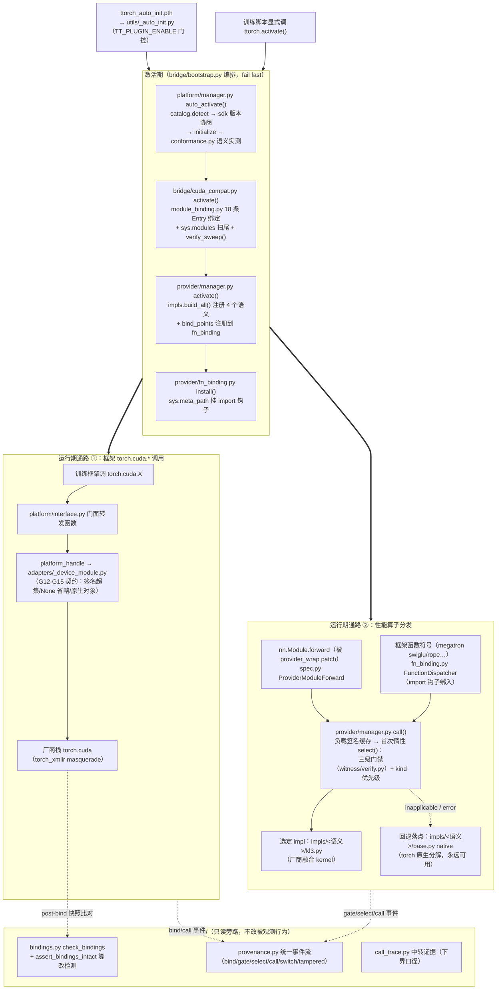

# TTorch

TTorch是面向异构设备的训练执行收束层，其职责是将上层训练框架的基础功能接入与模块级性能优化解耦，并以统一、可验证、可追踪的方式管理多硬件执行。

## 当前状态

**已穿透**：Qwen3.5-0.8B 在 KL3-XPU 上，由 TT 顶替厂商插件（xswift_ext /
xmegatron_ext）跑通完整 swift-megatron SFT —— 训练脚本一行不改，`exit 0`，
43/43 步，checkpoint 正常；与厂商插件的 loss 偏差为零均值噪声（正号 24 /
负号 19，均值 +2.4e-05）而非系统性 bias。

开发方针是**穿透优先、不铺开面**：完备性现阶段放低，未纳入 policy 的 API
直接报未实现，先把一条端到端链路打穿再扩面。当前 policy 18 个符号。

**provider 已起步**：bridge 之外补齐了性能实现层与观测层——首个真实 provider
（RMSNorm，KL3）跑通"自动注册→自动生效→自动选择"的整网使能（数值与厂商逐位一致），
并收拢观测/验证/溯源为独立的 witness 层。实测结论与经验教训见
`docs/TT_Provider_Function_Map.md` §6。

**megatron 链路已对齐**（2026-10-20）：函数级接入（通道 B）落地——swiglu /
bias_swiglu / rope_bshd 三个函数级 provider 顶替 XME 插件的融合优化，
Qwen3.5-0.8B SFT 整网 26s ≈ 厂商插件标杆 25s（gap 1.76x→1.04x）；其中 rope 的
厂商 backward kernel 被门禁的 bwd 对账拦下（fwd 逐位一致但梯度不等价），
保持原生——剩余 gap 即此一项，等厂商修复。

## 整体架构



图读法（与代码一一对应）：
- **激活期**（`bridge/bootstrap.py` 编排）：`platform/manager.py::auto_activate()` → `bridge/cuda_compat.py::activate()` → `provider/manager.py::activate()` → `provider/fn_binding.py::install()`，任一环节失败 fail fast；
- **通路 ①**：框架的 `torch.cuda.*` 调用 → `platform/interface.py` 门面 → `platform_handle`（`adapters/_device_module.py`）→ 厂商栈；
- **通路 ②**：被 wrap 的模块（`ProviderModuleForward`）与被绑的框架函数符号（`FunctionDispatcher`）都汇到 `provider/manager.py::call()`——首次调用惰性 `select()` 跑三级门禁（测量本体在 `witness/verify.py`），之后按负载签名缓存直通选定 impl，失败回退 `native`；
- **witness** 纯旁路：只读事件流与验证，不改变被观测行为。

## 目录

```
ttorch/              正式包（四层收束，顶层只做转发）
  __init__.py          统一入口：activate / device_spec / provider_wrap / check_bindings
                       / assert_bindings_intact / start_call_trace
  bridge/              CUDA 接口兼容（cuda_compat 符号决策）+ bootstrap（激活编排）
                       + checkpoint（save/resume + schema 校验 + RNG）
  platform/            Platform Manager：平台注册/检测/门禁/生命周期 + torch 接口暴露
  provider/            性能实现：两层 Provider/ProviderImpl + 自动注册/生效/选择；
                       模块级（wrap_module）与函数级（bind_points → fn_binding 后置
                       绑定通道，dispatcher 分发）两种接入形态共享门禁/回退/开关
  witness/             观测/验证/溯源：统一 provenance + bridge API 验证 + 运行期中转
                       + provider 精度/性能验证原语
  utils/               跨层共享的内部工具（**不算独立层**）：_rebind 符号替换动作的
                       唯一实现（bridge 与 provider 两个 writer 共用）、
                       _auto_init（.pth 自动激活钩子）
tests/               测试与验收（分层说明见 tests/README.md）
scripts/             工程工具（打包安装等）
examples/            可运行案例（机制演示 + 端到端回归，见 examples/README.md）
  bridge-demo/        mock 机制演示（假硬件走通 Bridge 设计意图，含 red 用例）
  provider-demo/      真实硬件（KL3）provider 机制演示（门禁/选择/回退/整网使能）
  schedule-demo/      schedule provider 机制演示（TP 通算 overlap）
docs/                架构设计与真实环境踩坑记录（G 系列）
```

## 快速开始

```bash
bash scripts/build_and_install.sh    # 打包 + 安装 + 校验

# 方式一：零侵入（.pth 自动激活，用户代码不动）
export TT_PLUGIN_ENABLE=1 XSWIFT_PLUGIN_ENABLE=0 XME_PLUGIN_ENABLE=0
python your_training_script.py

# 方式二：显式激活（脚本最开头，所有框架 import 之前）
import ttorch; ttorch.activate()
```

默认不激活——装了包不改变行为，这是可安全合入的前提。

## 设计要点

四层收束，依赖单向（bridge→platform、provider→platform、bridge/provider→witness）：
**bridge** 功能接入（CUDA 调用点接管 + checkpoint）、**platform** 硬件抽象、
**provider** module 级性能实现、**witness** 观测/验证/溯源。

- **两类决策分离**：`cuda_compat` 管框架 CUDA 调用点（remap / fallback /
  exception），Platform Manager 管平台注册/检测/激活与生命周期，统一接口是
  后者的顺带产物；
- **provider 失败只降性能不降功能**：每个 module provider 自带 native 底线
  （torch 原生单算子），高性能 impl 经三级门禁（功能/精度/收益）选用，
  失败/关闭即回退 native，可 kill switch 整体退场；
- **不支持即不实现，禁止身份判定**：接口默认抛 unsupported，平台不实现即不支持
  （`supports()` 内省存在性）；可选能力由 conformance 实测派生，不经平台自报；
  身份（vendor/device）由 spec 承载、实现类不许自报；
- **两层门禁**：admission 验绑定正确性，conformance 验 adapter 契约履行，
  任一不过拒绝激活；
- **惰性导入**：register 只登记轻量 spec，厂商实现在平台确定后才 import——
  厂商包 import 有副作用，且 PrivateUse1 设备模块是运行时注册的。

详见 `docs/`。真实环境踩坑（G9~G15）记录在
`docs/TT_Swift_Cuda_API_Inventory.md`，每条含症状、根因与一般化结论。
